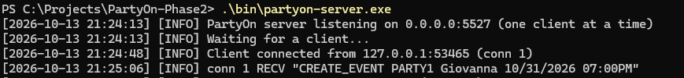
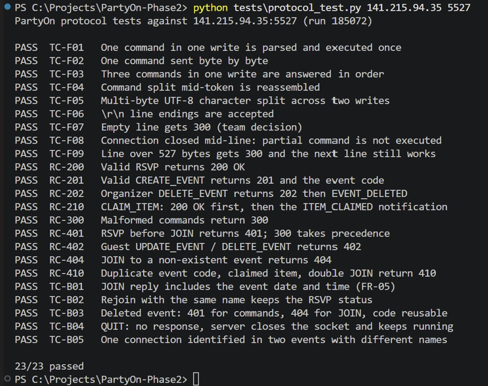
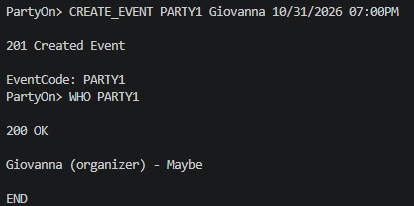
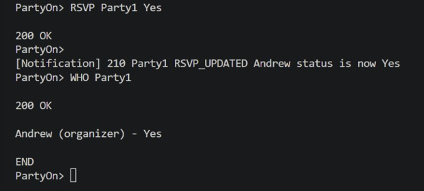
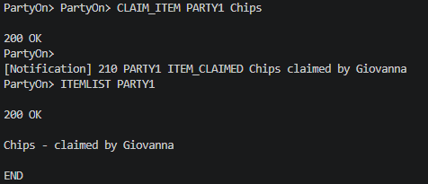
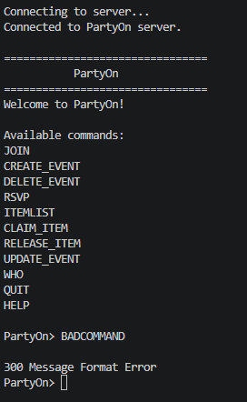
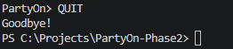
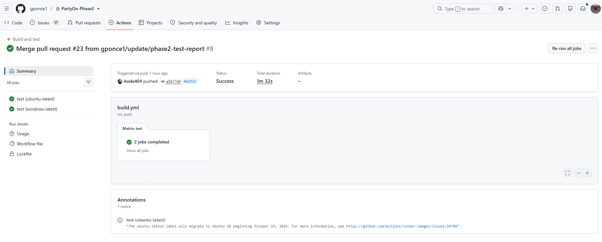

# PartyOn – Phase 2 Test Report

**Course:** CIS 527 – Computer Networks  
**Project:** Socket Programming Project – Phase 2  
**Team:** Group 4  
**Test Dates:** October 12–13, 2026  
**Testers:** Giovanna Ponce Cisternas, LaNaysha Simms, Andrew Luwaga  
**Version Tested:** Phase 2 / PartyOn Protocol v1.0

## 1. Scope

Phase 2 delivers a **Level 1** (one client at a time) PartyOn server and command-line client that follow `docs/UpdatedProtocolSpecification.md`. This report covers:

- message framing over TCP (Phase 1 test plan §9.3, TC-F01 to TC-F09)
- response-code coverage (§9.4)
- command behavior and team design decisions
- end-to-end runs with the real client
- logging and clean disconnects

Concurrency, race, and resilience tests (§9.5–9.6) need multiple simultaneous clients and are deferred to Phase 3.

## 2. Test Environment

Testing was performed in multiple environments to verify both local and cross-platform client-server behavior.

| Item | Local Test Environment | Cross-Machine Test Environment |
|---|---|---|
| Server OS | macOS 14 (Darwin 23.1) | macOS |
| Client OS | macOS 14 | Windows |
| Server compiler | Apple clang 15, C++17 | Apple clang, C++17 |
| Client compiler | Apple clang 15, C++17 | MinGW-w64 GCC 15.2, C++17 |
| Server build | `make server` | `make server` |
| Client build | `make client` | `g++ -std=c++17 client/client.cpp -o partyon-client.exe -lws2_32 -pthread` |
| Network | Loopback (`127.0.0.1`) | Two separate machines connected through the UM-Dearborn GlobalProtect VPN |
| Server address | `127.0.0.1` | Server VPN address (`141.215.94.35` during the recorded test) |
| Client address | Same machine | Windows VPN address (`141.215.95.94` during the recorded test) |
| TCP port | `5527` | `5527` |
| Raw-socket tests | Python 3 (`tests/protocol_test.py`) | Python 3 (`tests/protocol_test.py <server-VPN-IP> 5527`) |
| Connectivity check | Not required for loopback | Windows `Test-NetConnection <server-VPN-IP> -Port 5527` |
| CI environment | `ubuntu-latest` and `windows-latest` | GitHub Actions using MSYS2 UCRT64 / MinGW-w64 on Windows |
| Third-party dependencies | None | None |

The local environment was used for unit tests, framing tests, protocol conformance tests, and initial end-to-end integration.

Cross-machine testing was performed with the server running on macOS and the client running on a Windows machine. Both computers were connected to the UM-Dearborn GlobalProtect VPN because they were on different physical networks. TCP reachability to port `5527` was verified before starting the PartyOn client.

The cross-machine test confirmed that the client could connect to the remote server, send PartyOn protocol commands, receive the correct responses and notifications, and disconnect cleanly. The complete server-side record of this test is stored in `docs/two-machine-log.txt`.

GitHub Actions also builds and tests the project automatically on both Linux and Windows for every push.


## 3. How to reproduce

```bash
make                     # builds bin/partyon-server and bin/partyon-client
make test                # unit tests (no network)

./bin/partyon-server &   # in another terminal
python3 tests/protocol_test.py            # conformance tests over TCP
```

## 4. Results summary

| Suite | What it covers | Result |
|---|---|---|
| `tests/test_framer.cpp` | Line framing, TC-F01–F09, 527-byte boundary | **60 / 60 checks pass** |
| `tests/test_state.cpp` | All commands, all response codes, error precedence, notification recipients | **93 / 93 checks pass** |
| `tests/protocol_test.py` | Live server over TCP: framing, response codes, behavior | **23 / 23 tests pass** |
| End-to-end with `partyon-client` | Real client against real server, scripted session | **Pass** (display notes in §6) |
| Client oversized-line handling | Fake server sends 600- and 700-byte lines | **Pass**: warning shown, next reply displayed |
| **Two machines over VPN** (macOS server, Windows client) | Interactive client session + full conformance suite across the network | **Pass**: 23 / 23, see §5.5 |
| GitHub Actions: Linux and Windows | Build (no warnings), unit tests, conformance tests on a live server | **Pass on both** ([run 38276372268](https://github.com/gponce1/PartyOn-Phase2/actions/runs/38276372268)) |

**Overall result:** All required Phase 2 automated and manual tests passed. No blocking defects remain. The remaining open issues are cosmetic and do not affect protocol correctness or core functionality.

## 5. Detailed results

### 5.1 Framing (Phase 1 §9.3)

| ID | Objective | Expected | Actual | Result |
|---|---|---|---|---|
| TC-F01 | One command, one write | Parsed and executed once | One complete command was parsed and executed exactly once | Pass |
| TC-F02 | One command sent byte by byte | Parsed once, no timeouts | The command was reassembled correctly and executed once after the final byte arrived | Pass |
| TC-F03 | Three commands in one write | Three responses, in order | All three commands were parsed separately and three responses were returned in the correct order | Pass |
| TC-F04 | Command split mid-token | Reassembled correctly | The split command was buffered and reconstructed correctly before execution | Pass |
| TC-F05 | Multi-byte UTF-8 split across two writes | Reassembled correctly (`José`) | The UTF-8 character split across reads was reconstructed correctly as `José` | Pass |
| TC-F06 | `\r\n` line endings | Accepted, `\r` stripped | The command was accepted and the trailing `\r` was removed before processing | Pass |
| TC-F07 | Empty line | **300 Message Format Error** (team decision; Phase 1 plan said "ignored") | Server returned `300 Message Format Error` and continued running normally | Pass |
| TC-F08 | Connection closed mid-line | Partial command not executed | The incomplete command was discarded when the connection closed and was not executed | Pass |
| TC-F09 | Line over 527 bytes | `300 Message Format Error`, rest of line discarded, next line works | Server returned `300 Message Format Error`, discarded the oversized line, and correctly processed the next valid command | Pass |

The unit tests also check the exact limit: a 527-byte line including `\n` is accepted and a 528-byte line is rejected.

### 5.2 Response-code coverage (Phase 1 §9.4)

| Code | Trigger tested | Test ID | Result |
|---|---|---|---|
| 200 OK | Valid RSVP, CLAIM, RELEASE, UPDATE, WHO, ITEMLIST | RC-200, RC-210 | Pass |
| 201 Created Event | Valid CREATE_EVENT | RC-201 | Pass |
| 202 Deleted Event | Organizer DELETE_EVENT | RC-202 | Pass |
| 210 Notification | ITEM_CLAIMED, ITEM_RELEASED, EVENT_UPDATED, EVENT_DELETED, RSVP_UPDATED, each arriving after its response | RC-202, RC-210, RC-200 | Pass |
| 300 Message Format Error | Bad RSVP status, unknown/lowercase command, double space, extra field, `HELP` sent to server, invalid date/time, 101-byte field, invalid UTF-8, oversized line | RC-300, TC-F07, TC-F09 | Pass |
| 401 Not Identified | RSVP before JOIN; command on a deleted event | RC-401, TC-B03 | Pass |
| 402 Not Authorized | Guest UPDATE_EVENT / DELETE_EVENT | RC-402 | Pass |
| 404 Not Found | JOIN to non-existent or deleted event | RC-404, TC-B03 | Pass |
| 410 Conflict | Duplicate event code, claim of a claimed item, release of an unknown item, double JOIN | RC-410 | Pass |

Error precedence checks: a malformed command returns 300 even when the user isn't identified (RC-401) and even when the user isn't the organizer (unit tests).

### 5.3 Behavior and design decisions

| ID | Behavior | Result |
|---|---|---|
| TC-B01 | JOIN reply shows the event date and time (FR-05) | Pass |
| TC-B02 | Rejoining with the same name keeps the guest's RSVP | Pass |
| TC-B03 | Deleted event: 401 for commands, 404 for JOIN, code reusable, old identities not carried over | Pass |
| TC-B04 | QUIT: no response, server closes the socket and accepts the next client | Pass |
| TC-B05 | One connection identified in two events under different names | Pass |
| TC-B06 | Abrupt client disconnect: session removed, server keeps running | Pass (raw-socket run) |
| TC-B07 | Ctrl+C on the server: sockets closed, exit code 0 | Pass (macOS) |
| TC-B08 | Ctrl+C on the server shuts it down cleanly | Pass (manual Windows test) |

### 5.4 Command-level functional tests

The following tests verify every PartyOn client/server command individually, including the expected protocol response codes. `HELP` is also included for completeness, although it is handled locally by the client and is not sent to the server.

| ID | Command / Input | Expected Result | Actual Result | Status |
|---|---|---|---|---|
| TC-C01 | `CREATE_EVENT Party1 Andrew 10/31/2026 07:00PM` | `201 Created Event` followed by `EventCode: Party1` | Server returned `201 Created Event` and the correct event code | **Pass** |
| TC-C02 | `JOIN Party1 Sam` | `200 OK` followed by the event date and time | Server returned `200 OK` and the correct Party1 event information | **Pass** |
| TC-C03 | `RSVP Party1 Yes` | `200 OK`; applicable `210 RSVP_UPDATED` notification follows the response | Server returned `200 OK` and the RSVP update notification in the correct order | **Pass** |
| TC-C04 | `ITEMLIST Party1` | `200 OK`, item entries, then `END` | Server returned the complete item list terminated by `END` | **Pass** |
| TC-C05 | `CLAIM_ITEM Party1 Chips` | `200 OK` followed by a `210 ITEM_CLAIMED` notification | Server returned `200 OK`; the item was assigned correctly and the notification followed the response | **Pass** |
| TC-C06 | `RELEASE_ITEM Party1 Chips` | `200 OK` followed by a `210 ITEM_RELEASED` notification | Server returned `200 OK`; the item was released correctly and the notification followed the response | **Pass** |
| TC-C07 | `WHO Party1` | `200 OK`, participant entries with RSVP status, then `END` | Server returned the complete participant list terminated by `END` | **Pass** |
| TC-C08 | `UPDATE_EVENT Party1 11/01/2026 06:30PM` | `200 OK` followed by a `210 EVENT_UPDATED` notification | Server returned `200 OK`; the event date/time changed and the notification followed the response | **Pass** |
| TC-C09 | `DELETE_EVENT Party1` | `202 Deleted Event` followed by a `210 EVENT_DELETED` notification | Server returned `202 Deleted Event`; the event was removed and the notification followed the response | **Pass** |
| TC-C10 | `QUIT` | No protocol response; client connection closes and the server remains available for another client | Client displayed `Goodbye!`, the socket closed cleanly, and the server returned to waiting for a client | **Pass** |
| TC-C11 | `HELP` | Client displays the available command menu locally; no message is sent to the server | Command menu was displayed locally and no protocol request was sent | **Pass** |


### 5.5 Two-machine test (Phase 1 §9.2)

| | Server | Client |
|---|---|---|
| OS / build | macOS, Apple clang | Windows, MinGW-w64 GCC 15.2 (`g++ -std=c++17 client/client.cpp -lws2_32 -pthread`) |
| Network | UM-Dearborn GlobalProtect VPN, `141.215.94.35` | Same VPN from a home network, `141.215.95.94` |

| Step | Result |
|---|---|
| Reachability: `Test-NetConnection 141.215.94.35 -Port 5527` from Windows | `TcpTestSucceeded : True` |
| Interactive `partyon-client.exe` session: CREATE_EVENT, CLAIM_ITEM, WHO, ITEMLIST, RSVP, QUIT | All responses and notifications correct; clean disconnect |
| `python tests/protocol_test.py 141.215.94.35 5527` from Windows | **23 / 23 pass** |

The full server log for this run is in `docs/two-machine-log.txt`. Setup notes:
- The client machine has to be connected to the VPN. A first attempt from the home network failed, as expected, because the VPN address can only be reached from inside the VPN.
- macOS's firewall blocks our unsigned server binary until an allow rule is added (`socketfilterfw --add` / `--unblockapp`). The README troubleshooting section has the commands.

### 5.6 Logging

Every connection, received command, response code (with the reason for errors), notification, and disconnect is logged with a timestamp to the terminal and `server.log`. A sample from three client sessions is in `docs/server-log-sample.txt`.

## 6. Issues found

| # | Area | Issue | Severity | Status |
|---|---|---|---|---|
| 1 | Client | Did not discard incoming lines over 527 bytes (spec requires it of both sides) | Medium | **Fixed** on `aluwaga-feature/integration` |
| 2 | Mock server | Used port 5000 and `300 Invalid Command` | Low | **Fixed** (5527, `300 Message Format Error`) |
| 3 | Mock server | Did not compile on macOS: `bind` resolved to `std::bind` | Medium | **Fixed** (`::bind`) |
| 4 | Client display | A notification that arrives just after its response prints a second `PartyOn>` prompt | Low | Open (cosmetic), client owner |
| 5 | Client display | A blank line is printed before every server line, so multi-line replies show blank lines between rows | Low | Open (cosmetic), client owner |
| 6 | Client help | `HELP` lists command names only, without their arguments (NFR-02 / NFR-07) | Low | Open, client owner |

## 7. Final Verification

- [x] Build and test on **Windows**: build, unit tests, and conformance tests pass on GitHub Actions `windows-latest` (MSYS2 + MinGW-w64)
- [x] Interactive client session on a real Windows machine (§5.5)
- [x] One run **across two machines** (Phase 1 §9.2): macOS server, Windows client, over the school VPN (§5.5)
- [x] Server Ctrl+C shutdown verified manually on a real Windows machine; the server shuts down cleanly.
- [x] Final requirements traceability reviewed by the team.

## 8. Requirements traceability

| Req | Summary | Phase 2 status | Evidence |
|---|---|---|---|
| FR-01 | Connect by host/IP and port | Met | Client prompts; E2E run; two-machine run over VPN (§5.5) |
| FR-02 | Provide a username | Met | JOIN / CREATE_EVENT |
| FR-03 | Join an existing event | Met | TC-B01, RC-404 |
| FR-04 | Confirm or change attendance | Met | RC-200, TC-B02 |
| FR-05 | View event code, date, and time | Met | TC-B01 (JOIN reply), CREATE_EVENT, EVENT_UPDATED |
| FR-06 | View the contribution list | Met | ITEMLIST |
| FR-07 | Submit or claim an item | Met | RC-210 |
| FR-08 | See who brings each item | Met | ITEMLIST |
| FR-09 | Server keeps shared lists and RSVPs | Met | Unit tests, TC-B02 |
| FR-10 | Multiple users on the same event | Partial: users take turns (Level 1) | Phase 3 |
| FR-11 | Reject an item that is already claimed | Met (410); concurrent case in Phase 3 | RC-410 |
| FR-12 | Invalid request answered, no crash | Met | RC-300, TC-F09 |
| FR-13 | Exit option closes the connection | Met | TC-B04, E2E |
| FR-14, FR-15 | Important items and alerts | Future work | — |
| FR-16, FR-17 | Backup option, event history | Not implemented (Could Have) | — |
| FR-18 | Persist events across restarts | Not implemented | Phase 3 candidate |
| FR-19 | Several events per user | Met | TC-B05 |
| FR-20 | Reject duplicate usernames | **Superseded:** same name is a rejoin (team decision) | TC-B02 |
| FR-21 | Organizer can create an event | Met | RC-201 |
| FR-22 | Push updates to connected clients | Met for the connected client (Level 1); all clients in Phase 3 | RC-210 |

## 9. Test Evidence

### Figure 1 – Server startup

The PartyOn server starts successfully and listens on TCP port `5527`.



### Figure 2 – Two-machine connection over VPN

The Windows client successfully connects to the macOS server through the UM-Dearborn GlobalProtect VPN.



### Figure 3 – CREATE_EVENT and WHO

The client creates an event successfully and retrieves the participant list.



### Figure 4 – RSVP and notification

The server returns `200 OK` and then sends the `210 RSVP_UPDATED` notification.



### Figure 5 – CLAIM_ITEM and ITEMLIST

The item is successfully claimed and appears in the event item list.



### Figure 6 – Invalid request handling

Malformed or invalid input returns the expected `300 Message Format Error` without crashing the server.



### Figure 7 – Graceful disconnect

The client sends `QUIT`, closes cleanly, and the server returns to waiting for another connection.



### Figure 8 – Automated CI testing

GitHub Actions confirms successful build and test execution on both Linux and Windows.



Additional evidence:
- [`server-log-sample.txt`](../docs/server-log-sample.txt)
- [`two-machine-log.txt`](../docs/two-machine-log.txt)

## 10. Conclusion

Phase 2 of PartyOn successfully implements the required Level 1 client-server application over TCP. The client and server successfully establish connections, exchange newline-framed protocol messages, execute the complete Phase 2 command set, handle malformed requests, produce the specified response codes, log activity, and disconnect cleanly.

All framing unit tests (60/60), state and command tests (93/93), and TCP conformance tests (23/23) passed. The project also builds and passes its automated test suites on both Linux and Windows through GitHub Actions.

Cross-platform integration was additionally verified using a macOS server and a Windows client running on separate machines connected through the University GlobalProtect VPN.

The remaining known issues are limited to minor client display and help text behavior and do not affect the network protocol or core Phase 2 functionality.

Based on the completed testing, PartyOn satisfies the required Phase 2 functionality and is ready to proceed to Phase 3, where simultaneous client connections and concurrency will be introduced.